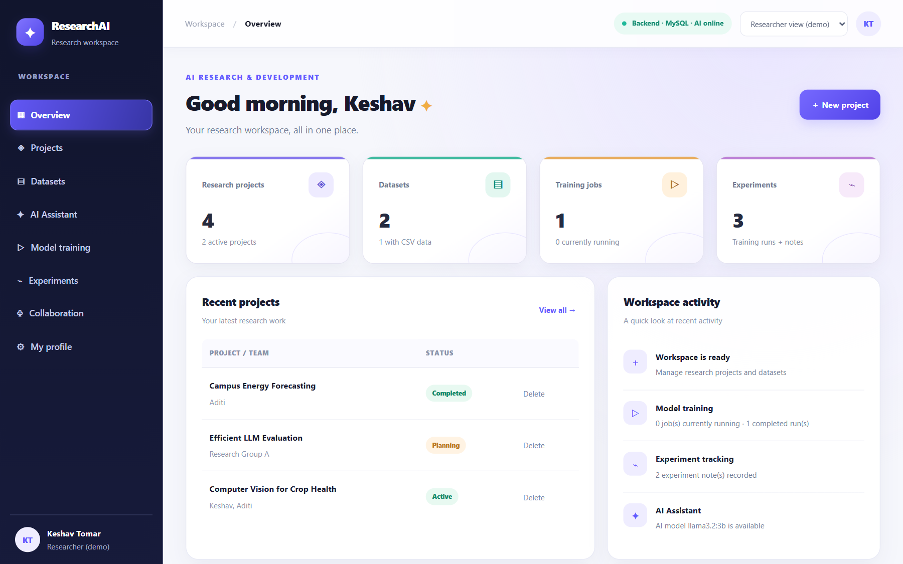
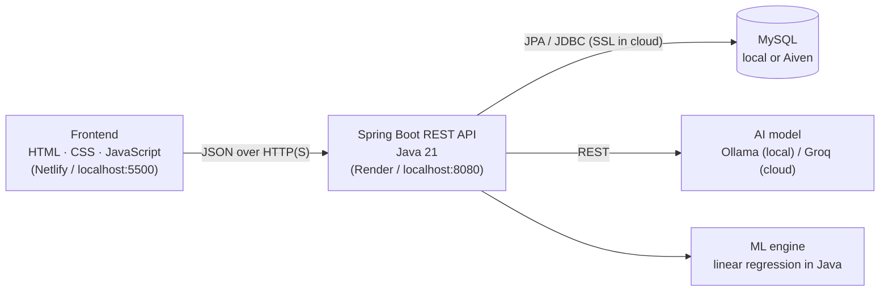
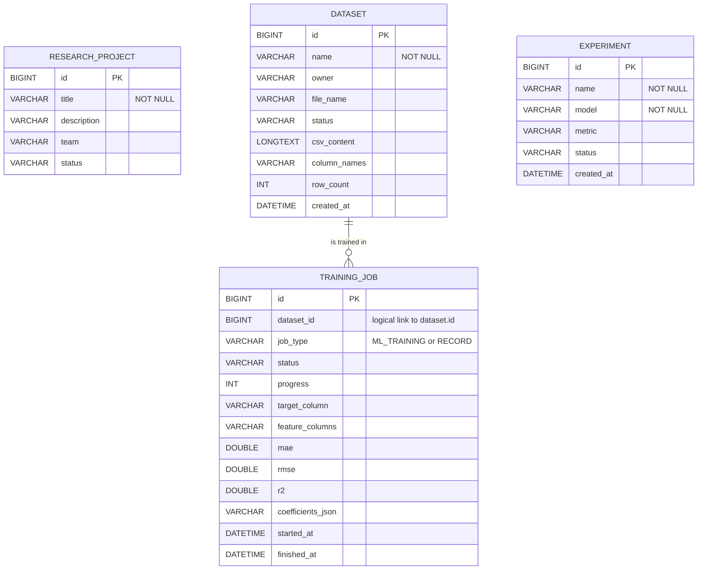
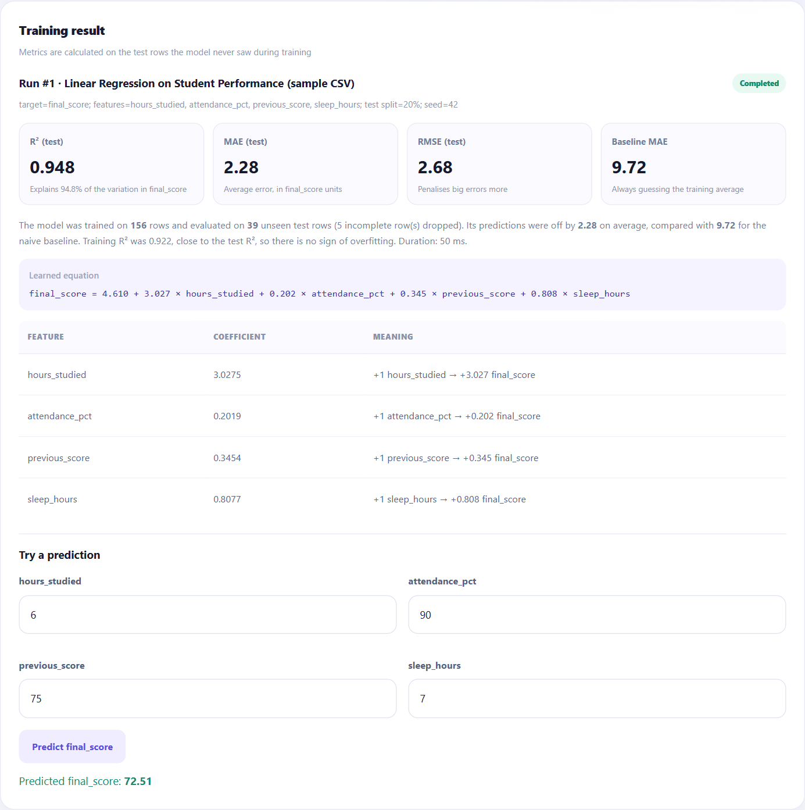
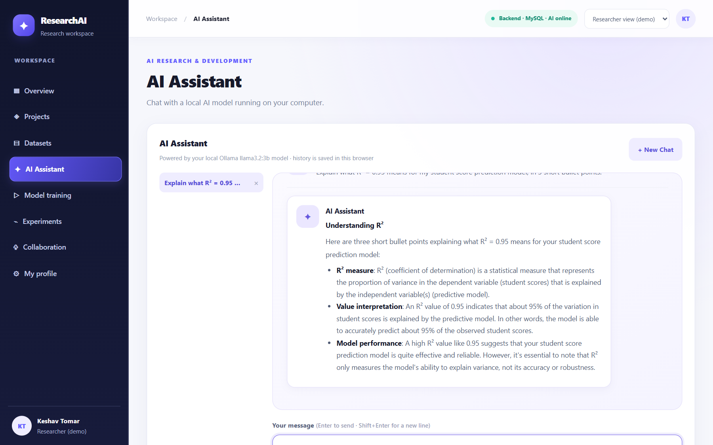
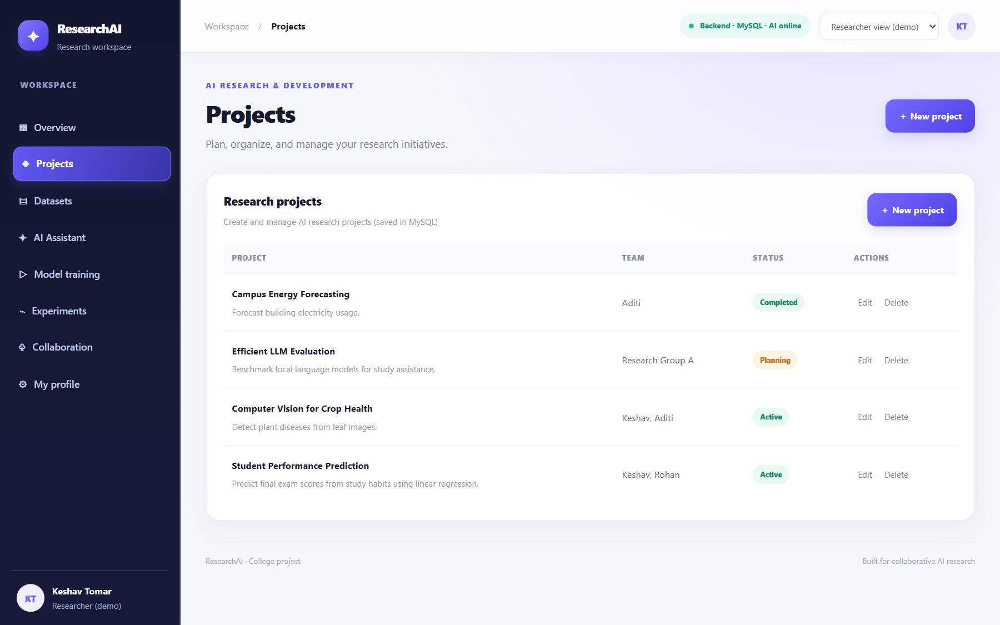
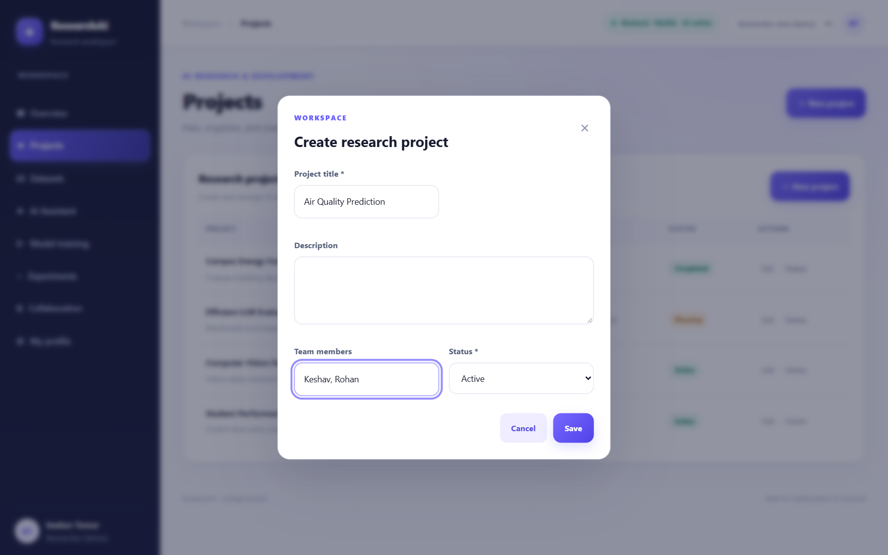
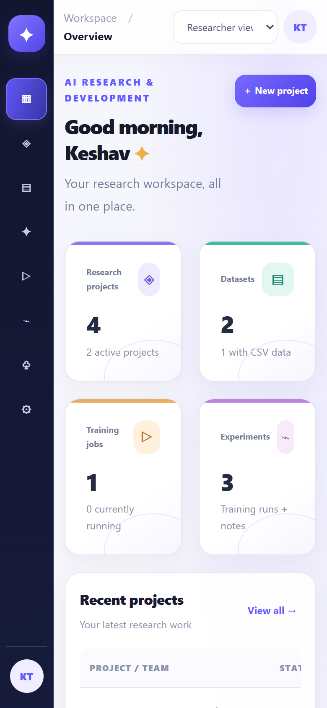

# ResearchAI: AI Research & Development Platform (College Project)

A research-management dashboard with a **Java Spring Boot** backend, a **MySQL** database, a **local AI assistant** (Ollama, no API key needed), and a **real machine-learning workflow**: linear-regression training on CSV data, with proper train/test evaluation.

**Live demo:** https://fantastic-pavlova-37ef51.netlify.app (the free backend may take about 1 minute to wake up on the first visit)
**Presentation (Review 1):** [PDF](docs/presentation/ResearchAI_Review1.pdf) · [PPTX](docs/presentation/ResearchAI_Review1.pptx)



## Architecture



Backend layers: **Controller** (HTTP + JSON) → **DTO validation** → **Service / ML** → **Repository** (Spring Data JPA) → **Entity** (MySQL table).

## Database design



Full schema: [database/schema.sql](database/schema.sql). The first three tables use JPA/Hibernate; `experiment` is read and written with plain JDBC (`JdbcExperimentDao`). `training_job.dataset_id` is a logical link without a database constraint, so a training run keeps its results even if its dataset is later deleted.

## Screenshots

| Model training (real metrics) | AI Assistant |
|---|---|
|  |  |

| Projects (MySQL data) | Create form | Phone view |
|---|---|---|
|  |  |  |

| Part | Technology | URL |
|------|------------|-----|
| Frontend | HTML, CSS, vanilla JavaScript | http://localhost:5500 |
| Backend API | Java 21, Spring Boot 3.4, Maven | http://localhost:8080/api |
| Database | MySQL 8, database `ai_research_platform` | localhost:3306 |
| Local AI | Ollama + `llama3.2:3b` | http://localhost:11434 |

> **Deploying online for free?** See **[DEPLOY.md](DEPLOY.md)**: Netlify + Render + free MySQL + Groq's free AI API, no laptop needed.

## Core Java concepts: where to find them

| Concept | Where it is used (in `backend/src/main/java/com/aiplatform/`) |
|---------|------------------------------------------------------------------|
| **Interfaces** | `service/ChatProvider` (AI providers), `dao/ExperimentDao` (database operations), Spring Data repositories |
| **Inheritance** | `exception/ResearchAiException` → `TrainingDataException`, `NotFoundException`, `DaoException`; `web/ExportServlet extends HttpServlet`; `config/AccessKeyFilter extends OncePerRequestFilter` |
| **Polymorphism** | `ChatProvider` has two implementations (`OllamaService`, `OpenAiCompatibleService`), and `config/AiConfig` picks one at runtime. Each exception subclass overrides `status()`, so `GlobalExceptionHandler` has a single handler for all of them. |
| **Encapsulation** | JPA entities in `model/` (private fields + getters/setters); immutable `record` DTOs in `dto/` |
| **Exception handling** | Custom exception hierarchy; `config/GlobalExceptionHandler` (JSON errors, no stack traces sent to the browser); try-with-resources and `SQLException` wrapping in `dao/JdbcExperimentDao` |
| **Collections & generics** | `List`, `Map`, `Set`, `Deque`, `Optional`; `ConcurrentHashMap` in `service/AiRateLimiter`; generic `JpaRepository<T, ID>`, `ServletRegistrationBean<ExportServlet>` |
| **Multithreading & synchronization** | `ml/TrainingService`: training runs on a `ThreadPoolExecutor` with a bounded queue. `service/AiRateLimiter`: `synchronized` block. `service/OpenAiCompatibleService`: `volatile` cached status. |
| **JDBC** | `dao/JdbcExperimentDao`: `DataSource` → `Connection` → `PreparedStatement` → `ResultSet`, generated keys, and a **transaction** with `commit()` / `rollback()`. `controller/HealthController`: `Connection.isValid()`. The other tables use JPA/Hibernate, which runs on JDBC. |
| **Classes for database operations** | `dao/` (plain JDBC DAO), `repository/` (Spring Data JPA), `model/` (entities) |
| **Servlets & web integration** | `web/ExportServlet` (`HttpServlet.doGet`, response headers, CSV download), registered in `config/ServletConfig`; `config/AccessKeyFilter` (servlet filter); REST controllers in `controller/` (Spring's `DispatcherServlet`) |

---

## 1. What is real and what is demo

| Feature | Where the data lives | Status |
|---------|---------------------|--------|
| Projects (create, edit, delete) | **MySQL** via `/api/projects` | Working, tested |
| Datasets (CSV upload, metadata, edit, delete) | **MySQL** via `/api/datasets` | Working, tested |
| Model training (linear regression) | Runs in the **Java backend**, results saved in **MySQL** | Working, tested |
| Predictions with a trained model | `/api/training/{id}/predict` | Working, tested |
| AI Assistant (multi-turn chat) | Answers from **local Ollama**; chat history saved in **your browser** (localStorage) | Working, tested |
| Experiment notes (create, edit, delete) | **MySQL** via `/api/experiments`, using **plain JDBC** (`JdbcExperimentDao`) | Working, tested |
| CSV downloads (training results, experiments) | `ExportServlet`, a plain **Java Servlet** at `/export/*` | Working, tested |
| Collaboration, Users, Resources, Usage, Profile | **Demo data in the browser only** | Demo |
| Researcher/Admin switch | Changes the view only. **It is not a login and provides no security.** | Demo |

---

## 2. Prerequisites (Windows)

Install these once:

1. **JDK 21**: check with `java -version`.
2. **Maven 3.9+**: check with `mvn -v`.
3. **MySQL Server 8**: the Windows service is usually called `MySQL80`.
4. **Ollama**: https://ollama.com/download
5. **Python 3**: used only to serve the frontend folder (`python -m http.server`).

Check everything in **PowerShell**:

```powershell
java -version
mvn -v
python --version
ollama --version
Get-Service MySQL80
```

---

## 3. One-time setup

### 3.1 MySQL database

The backend creates and updates its tables automatically. You only need the database itself. In **MySQL Workbench** or **MySQL Shell** (`mysqlsh --sql -u root -p`), run:

```sql
CREATE DATABASE IF NOT EXISTS ai_research_platform;
```

Optionally, run the full schema file, which creates the same tables the backend would create:

```powershell
mysqlsh --sql -u root -p -f database\schema.sql
```

### 3.2 Database password: keep it out of the code

The password is **not** stored in `application.properties`. Use **either** option.

**Option A: local file (easiest).** Copy the example and edit it:

```powershell
cd backend\config
Copy-Item local.properties.example local.properties
notepad local.properties      # set DB_PASSWORD=your_mysql_password
cd ..\..
```

`backend/config/local.properties` is listed in `.gitignore`, so it is never committed.

**Option B: environment variables** (for the current PowerShell window only):

```powershell
$env:DB_USERNAME = "root"
$env:DB_PASSWORD = "your_mysql_password"
```

Environment variables take priority over `local.properties`. Other settings you can override the same way:

| Variable | Default | Purpose |
|----------|---------|---------|
| `DB_URL` | `jdbc:mysql://localhost:3306/ai_research_platform` | Database address |
| `SERVER_PORT` / `PORT` | `8080` | Backend port (`PORT` is set by cloud hosts) |
| `CORS_ALLOWED_ORIGINS` | `http://localhost:5500,http://127.0.0.1:5500` | Websites allowed to call the API |
| `AI_PROVIDER` | `ollama` | `ollama` (local), `groq` or `openai-compatible` (cloud APIs) |
| `AI_API_KEY`, `AI_MODEL`, `AI_BASE_URL` | – | Only for cloud AI providers (see DEPLOY.md) |
| `OLLAMA_BASE_URL`, `OLLAMA_MODEL` | `http://localhost:11434`, `llama3.2:3b` | Local Ollama settings |
| `APP_ACCESS_KEY` | *(empty = off)* | Shared demo password required for changes and AI on a public deployment |
| `AI_RATE_LIMIT_PER_MINUTE`, `AI_GLOBAL_LIMIT_PER_MINUTE` | `10`, `30` | Limits AI messages per visitor / in total |

### 3.3 Ollama model

```powershell
ollama pull llama3.2:3b
ollama list            # should show llama3.2:3b
```

Ollama usually runs automatically in the background after installation (system tray icon). If it isn't running, start the Ollama app or run `ollama serve` in a separate window.

---

## 4. Running the project (3 windows)

**Window 1: backend**

```powershell
cd C:\Users\LOQ\Downloads\AI_Research_Platform_College_Project\backend
mvn spring-boot:run
```

Wait for `Started AiResearchPlatformApplication`. Then check in a browser: http://localhost:8080/api/health

```json
{"status":"UP","application":"AI Research Platform","database":"UP","ai":"UP","aiProvider":"ollama","model":"llama3.2:3b","accessKeyRequired":false}
```

**Window 2: frontend**

```powershell
cd C:\Users\LOQ\Downloads\AI_Research_Platform_College_Project\frontend
python -m http.server 5500
```

Open **http://localhost:5500**. The pill in the top bar should say **"Backend · MySQL · AI online"**.

> Always open the site through `http://localhost:5500`, not by double-clicking `index.html`. The backend only accepts requests from `http://localhost:5500` and `http://127.0.0.1:5500` (CORS).

**Window 3: quick automated check (optional)**

```powershell
cd C:\Users\LOQ\Downloads\AI_Research_Platform_College_Project
powershell -ExecutionPolicy Bypass -File scripts\smoke-test.ps1
```

This checks health, MySQL, project CRUD, validation, a real training run, and an AI answer. It creates and deletes one test project and loads the sample dataset. For an online backend add `-BaseUrl https://…/api -AccessKey …`.

---

## 5. The machine-learning workflow

### What happens when you click "Train model"

1. **Load**: the CSV stored in MySQL is parsed. Quotes, commas inside quotes, and Windows line endings are handled.
2. **Validate**: the target and feature columns must exist and be numeric. A text value such as `S001` makes the job **fail** with a clear message. A CSV is limited to 2 MB, 50 columns, and 50,000 rows.
3. **Clean**: rows with a missing value (empty, `NA`, `N/A`, `NaN`, `null`, `?`) in a selected column are dropped and counted.
4. **Split**: rows are shuffled with the chosen **random seed** and split into train/test sets (default 80/20). The same seed always gives the same split and the same result.
5. **Train**: ordinary-least-squares **linear regression** is fitted on the *training rows only* (`backend/src/main/java/com/aiplatform/ml/LinearRegression.java`).
6. **Evaluate**: predictions are made for the *test rows*, which the model never saw, and these metrics are calculated:
   - **MAE**: average size of a mistake, in the target's units.
   - **RMSE**: like MAE, but big mistakes count more.
   - **R²**: share of the target's variation explained (1 = perfect, 0 = no better than guessing the average).
   - **Baseline MAE**: the error from always predicting the training average. A useful model must beat this.
   - **Train R²**: if it is much higher than test R², the model is overfitting.
7. **Save**: the status (`Queued → Running → Completed/Failed`), progress, metrics, and learned coefficients are written to the `training_job` table **as each step really finishes**. Training on 200 rows takes only milliseconds, so it may go straight from Queued to Completed.

### Sample dataset

Click **Load sample dataset** on the Model training page, or **Load sample CSV** on the Datasets page. The file is `backend/src/main/resources/sample-data/student_performance.csv`.

It is **synthetic** (generated, not real students) so the result can be checked. `scripts/generate_sample_data.py` created it with this formula:

```
final_score = 2 + 3.0*hours_studied + 0.2*attendance_pct + 0.35*previous_score + 1.2*sleep_hours + random noise (sd 3.5)
```

200 rows; 5 rows have a missing value on purpose.

**Expected result** (target `final_score`, all 4 features, 20% test, seed 42), measured on this machine:

| Metric | Value | Meaning |
|--------|-------|---------|
| R² (test) | 0.948 | Explains about 95% of the variation |
| MAE (test) | 2.28 | Predictions are off by about 2.3 points on average |
| RMSE (test) | 2.68 | |
| Baseline MAE | 9.72 | The model is about 4× better than guessing the average |
| Coefficients | hours 3.03, attendance 0.20, previous 0.35, sleep 0.81 | Close to the true 3.0, 0.2, 0.35, 1.2. Sleep is the least precise because it has the smallest range and the data is noisy. |
| Rows | 156 train / 39 test / 5 dropped | |

Because the true formula is known, a near-match proves the model really learned from the data; no result is hard-coded.

### Using your own CSV

Datasets → **＋ Add dataset** → choose a `.csv` file (max 2 MB). Requirements: the first row holds column names, values are comma-separated, the target and feature columns are numeric, and at least 10 complete rows remain after cleaning.

---

## 6. API reference

All endpoints are under `http://localhost:8080/api`. Errors always come back as `{"error": "message"}` and never include stack traces. If `APP_ACCESS_KEY` is set, POST/PUT/DELETE requests need the header `X-Access-Key: <key>`; GET requests stay open.

| Method | Path | Description |
|--------|------|-------------|
| GET | `/health` | Backend, database and Ollama status |
| GET / POST | `/projects` | List / create (`title` required; `status` = Active, Planning, Completed, On hold) |
| GET / PUT / DELETE | `/projects/{id}` | Read / update / delete |
| GET / POST | `/datasets` | List / create a metadata-only dataset |
| GET / PUT / DELETE | `/datasets/{id}` | Read / update metadata / delete |
| POST | `/datasets/upload` | Multipart upload: `file` (.csv), `name`, `description`, `owner` |
| POST | `/datasets/sample` | Load the sample CSV (returns the existing one if already loaded) |
| GET | `/datasets/{id}/preview` | Columns, numeric columns, missing counts, first rows |
| GET | `/training` | All training jobs (newest first) |
| POST | `/training/run` | Start real training: `datasetId`, `targetColumn`, `featureColumns[]`, `testRatio` (0.1–0.5), `randomSeed` |
| GET | `/training/{id}` | Job status, metrics, coefficients |
| POST | `/training/{id}/predict` | `{"features": {"col": number, ...}}` → prediction |
| POST | `/training` | Record an external job ("Record only"; nothing is trained) |
| GET / POST | `/experiments` | List / create experiment notes (plain JDBC) |
| GET / PUT / DELETE | `/experiments/{id}` | Read / update / delete an experiment note |
| POST | `/experiments/batch` | Create several notes in **one transaction** (all or nothing) |
| GET | `/export/training-results.csv`, `/export/experiments.csv` | CSV downloads from `ExportServlet` (note: no `/api` prefix) |
| DELETE | `/training/{id}` | Delete a job (not allowed while it is running) |
| POST | `/ai/chat` | `{"messages":[{"role":"user","content":"..."}]}` or `{"prompt":"..."}` → `{"response","model","provider"}` (limited per minute) |

PowerShell examples:

```powershell
Invoke-RestMethod http://localhost:8080/api/health

Invoke-RestMethod http://localhost:8080/api/projects -Method Post -ContentType "application/json" `
  -Body '{"title":"Crop disease detection","team":"Keshav, Aditi","status":"Active"}'

$d = Invoke-RestMethod http://localhost:8080/api/datasets/sample -Method Post
$job = Invoke-RestMethod http://localhost:8080/api/training/run -Method Post -ContentType "application/json" `
  -Body (@{datasetId=$d.id; targetColumn="final_score"; featureColumns=@("hours_studied","attendance_pct","previous_score","sleep_hours"); testRatio=0.2; randomSeed=42} | ConvertTo-Json)
Start-Sleep 1; Invoke-RestMethod "http://localhost:8080/api/training/$($job.id)"

Invoke-RestMethod http://localhost:8080/api/ai/chat -Method Post -ContentType "application/json" `
  -Body '{"prompt":"Explain overfitting in two sentences."}'
```

Upload a CSV with curl (built into Windows 10/11):

```powershell
curl.exe -F "file=@C:\path\to\data.csv" -F "name=My data" -F "owner=Keshav" http://localhost:8080/api/datasets/upload
```

---

## 7. Automated tests

```powershell
cd backend
mvn test
```

There are 44 tests. They use a **temporary in-memory H2 database** and **fake AI servers** (Ollama and Groq-style), so they never touch your MySQL data and don't need Ollama or an API key. They cover:

- Regression maths: exact coefficient recovery, a hand-calculated example, constant/collinear feature detection.
- Metrics: MAE, RMSE, R² checked against a published scikit-learn example.
- CSV parsing: quotes, BOM, missing values, malformed files.
- API: project and dataset CRUD, validation errors, CSV upload, sample-dataset de-duplication, the full training run (with reproducibility, prediction, and failure on bad data), record-only jobs, chat (success, missing model, empty answer, Ollama down), and CORS.
- JDBC DAO: create/read/update/delete, an SQL-injection attempt stored as plain text, and transaction rollback when one row of a batch fails.
- Servlet: real HTTP download of the CSV files on a random port, CSV quoting, and protection against spreadsheet-formula injection.
- Exception hierarchy: each subclass returns the right HTTP status, and SQL details are never exposed.
- Cloud mode: Groq-style provider (the API key is sent only from the server and never appears in errors; bad key; quota exceeded), access key (blocks changes, allows viewing, error readable by the browser), and the AI rate limit.

---

## 8. Manual end-to-end test checklist

1. **Health:** the top-bar pill says "Backend · MySQL · AI online".
2. **Modal Cancel:** Projects → ＋ New project → click **Cancel** with empty fields. The modal closes with no "required field" warning. Repeat with **×** and with the **Esc** key.
3. **Modal validation:** click **Save** with an empty title. The browser asks you to fill it in, and nothing is saved.
4. **Persistence:** create a project, then refresh the page. It is still there. Check it in MySQL: `SELECT * FROM ai_research_platform.research_project;`
5. **Edit / Delete:** edit the project, refresh (the change is kept), then delete it. It disappears from MySQL too.
6. **Backend error:** stop the backend (Ctrl+C in Window 1) and try to save a project. The modal stays open with an error, and no fake "success" appears. Start the backend again and click **Retry**.
7. **ML:** Model training → **Load sample dataset** → **Train model**. Metrics appear (R² ≈ 0.95). Enter values under "Try a prediction".
8. **ML failure:** upload a CSV with fewer than 10 rows (for example `x,y` with 3 rows) and train on it. The job shows **Failed** with an explanation, and no fake metrics appear.
9. **Chat:** send a message with **Enter**. **Shift+Enter** adds a new line instead of sending. While waiting, the button shows "Thinking...".
10. **Chat history:** go to another page and come back, then refresh the browser. The conversation is still there. **＋ New Chat** starts an empty conversation, and older ones stay in the list on the left (× deletes one).
11. **Chat error:** stop Ollama and send a message. A red "Could not get an answer" message appears and is saved in the history.

---

## 9. Troubleshooting

| Problem | Fix |
|---------|-----|
| `Port 8080 was already in use` | An old backend is still running. Find it: `Get-NetTCPConnection -LocalPort 8080 -State Listen \| Select OwningProcess`, then stop it: `Stop-Process -Id <PID>`. Or run on another port: `$env:SERVER_PORT="8081"` (you would then also need to change `API_BASE` in `frontend/app.js`). |
| `Communications link failure` at startup | MySQL is not running: `Start-Service MySQL80` (as Administrator). |
| `Access denied for user 'root'` | Wrong password. Check `backend/config/local.properties` or `$env:DB_PASSWORD`. |
| `Unknown database 'ai_research_platform'` | Run `CREATE DATABASE ai_research_platform;` (section 3.1). |
| Pill says "Backend offline" | The backend is not running, or you opened the page from a file instead of `http://localhost:5500`. |
| Pill says "Online · AI offline" | Start the Ollama app or run `ollama serve`. |
| Chat error "model … is not installed" | `ollama pull llama3.2:3b` |
| First AI answer is slow | The model loads into memory on first use (10–60 s). Later answers are faster. |
| Frontend page will not open | Start the frontend server: `python -m http.server 5500` inside the `frontend` folder. |
| Browser console shows a CORS error | Open the site from `http://localhost:5500`, or add your address to `CORS_ALLOWED_ORIGINS`. |

---

## 9a. Online deployment (Render)

See **[DEPLOY.md](DEPLOY.md)**: step-by-step setup, the exact Render environment variables, and fixes for Render errors.

---

## 10. College demo script (about 7 minutes)

1. **Intro (30 s):** "ResearchAI helps a student research team manage projects and datasets, train a model, and get help from an AI assistant that runs entirely on this laptop: no paid API, no data leaves the machine."
2. **Architecture (45 s):** browser (HTML/JS) → Spring Boot REST API → MySQL, plus Spring Boot → Ollama. Point at the health pill.
3. **Projects (1 min):** create a project, refresh the page to show it persists, show the row in MySQL Workbench, edit it, delete it. Show that **Cancel** closes the form without saving.
4. **Dataset + ML (2.5 min):** load the sample CSV and show the preview with its missing-value warning and the non-numeric `student_id`. Train the model, then explain R², MAE, and the baseline comparison. Show the learned equation next to the generation formula (3.0 / 0.2 / 0.35 / 1.2) to prove it learned. Make one prediction. Then show an honest failure by training with too little data.
5. **AI Assistant (1.5 min):** ask "Explain what R² means for my model", then a follow-up question to show it keeps context. Refresh the page to show the history persisted. Mention that AI output is rendered safely (HTML is escaped).
6. **Honest limitations (30 s):** the role switch is a demo, not a login; some admin pages use demo data; training is single-machine linear regression.

---

## 11. Known limitations and what a real deployment would need

- **No user accounts.** Locally, anyone who can reach the backend can change data. Online, set `APP_ACCESS_KEY` (a shared demo password). A real product needs Spring Security with hashed passwords (BCrypt) or an identity provider, plus per-user authorization.
- Admin, Users, Resources, Usage, Collaboration and Experiment notes are **browser-only demo data**.
- Chat history is stored **per browser** (localStorage), not in MySQL, so it doesn't follow you to another computer.
- Only **linear regression** on numeric columns is supported. There is no categorical encoding or feature scaling, and no other algorithms.
- Training runs **inside the backend process** (2 at a time, up to 20 queued). A running job is marked Failed if the backend restarts.
- CSV files are stored in MySQL (max 2 MB each), which is fine for a demo but not for large data.
- `spring.jpa.hibernate.ddl-auto=update` changes tables automatically. Production should use a migration tool (Flyway/Liquibase) and `validate`.
- Free cloud hosting (see DEPLOY.md) sleeps when idle, and free AI APIs have usage limits. The AI rate limiter counts in memory and resets when the server restarts.

---

## 12. Project structure

```
backend/
  config/local.properties.example   ← copy to local.properties (git-ignored) for your DB password
  src/main/java/com/aiplatform/
    controller/   REST endpoints (health, projects, datasets, training, experiments, AI chat)
    dao/          ExperimentDao interface + JdbcExperimentDao (plain JDBC)
    exception/    custom exception hierarchy (ResearchAiException and subclasses)
    web/          ExportServlet (plain HttpServlet for CSV downloads)
    dto/          request/response objects with validation rules
    ml/           CsvTable, LinearRegression, RegressionMetrics, TrainingService
    model/        JPA entities (MySQL tables) + Experiment record
    repository/   Spring Data repositories
    service/      ChatProvider: OllamaService (local) / OpenAiCompatibleService (Groq etc.), AiRateLimiter
    config/       CORS, access key, AI provider choice, servlet registration, global error handling
  src/main/resources/sample-data/student_performance.csv
  src/test/       44 automated tests (H2 + fake AI servers + real HTTP for the servlet)
database/schema.sql                 ← optional manual schema
Dockerfile                          ← used by Render (builds the backend)
backend/Dockerfile                  ← same, for building from inside backend/
frontend/ index.html, config.js (backend address), app.js, style.css
scripts/ smoke-test.ps1, generate_sample_data.py
DEPLOY.md                           ← free online deployment guide
docs/presentation/                  ← Review 1 slides (PDF + PPTX)
docs/screenshots/                   ← UI screenshots used in README and slides
netlify.toml                        ← tells Netlify to publish the frontend folder
```
